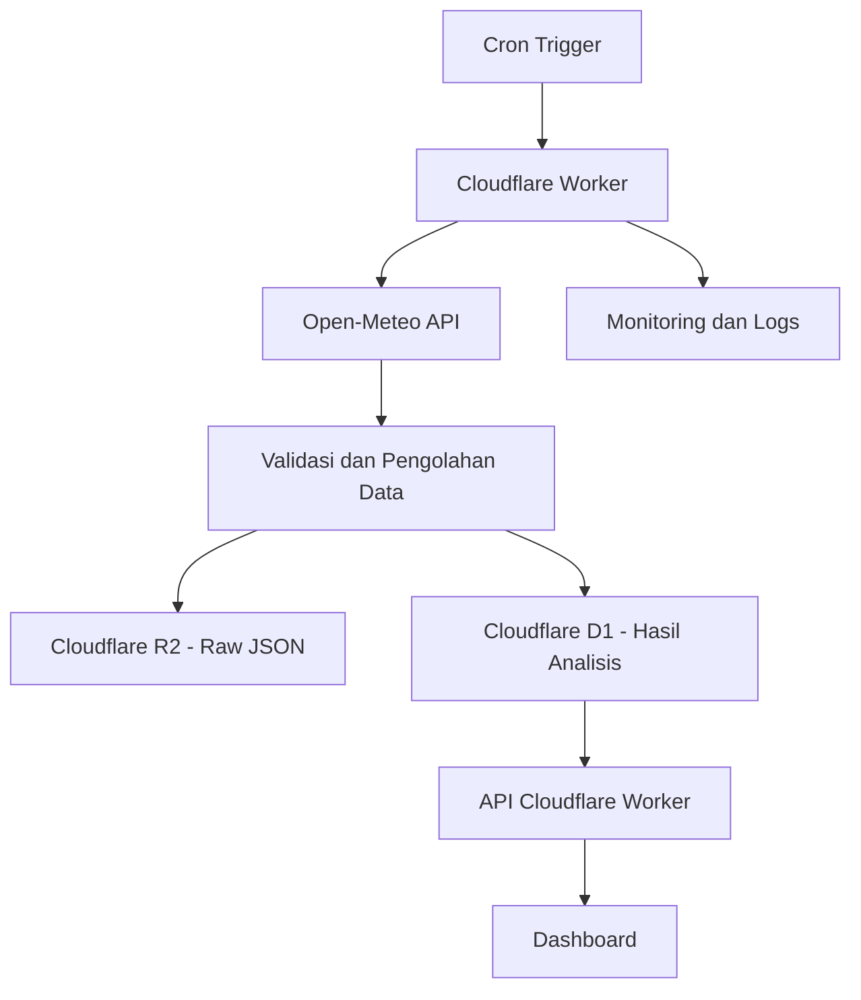

# kopwan-kelompok-4-topik-1

# Pipeline Data Terbuka Serverless dan Dashboard

## 1. Deskripsi Proyek

Proyek ini merupakan implementasi pipeline data terbuka berbasis serverless menggunakan layanan Cloudflare untuk mengambil, mengolah, menyimpan, dan menampilkan data prakiraan cuaca Jakarta secara otomatis.

Sistem menggunakan Open-Meteo API sebagai sumber data publik. Data yang diperoleh kemudian diproses menggunakan Cloudflare Workers sebagai layanan Function as a Service (FaaS).

Data mentah disimpan pada Cloudflare R2 Object Storage, sedangkan hasil analisis disimpan pada Cloudflare D1 Database. Hasil pengolahan kemudian disajikan melalui dashboard berbasis web.

Proyek ini dikembangkan sebagai pemenuhan tugas kelompok mata kuliah Komputasi Awan.

## 2. Tujuan Proyek

Tujuan pengembangan sistem ini adalah:

1. Mengimplementasikan pipeline pengambilan data publik secara otomatis menggunakan teknologi serverless.
2. Mengolah data prakiraan cuaca berdasarkan indikator yang telah ditentukan.
3. Menyimpan data mentah dan hasil pengolahan menggunakan layanan penyimpanan cloud terkelola.
4. Menampilkan hasil analisis deskriptif dan tren melalui dashboard.
5. Menerapkan monitoring, pencatatan eksekusi, dan penanganan kegagalan pada layanan cloud.
6. Mengevaluasi estimasi dan penggunaan biaya aktual layanan Cloudflare.

## 3. Sumber Dataset

Dataset yang digunakan berasal dari Open-Meteo Weather Forecast API.

Informasi dataset:

| Komponen | Keterangan |
|---|---|
| Sumber | Open-Meteo |
| Jenis data | Prakiraan cuaca |
| Wilayah | Jakarta, Indonesia |
| Format | JSON |
| Interval | Per jam |
| Periode | Prakiraan 3 hari |
| Pembaruan | Setiap hari |
| Jumlah indikator | 3 |

Indikator yang digunakan:

| Indikator | Nama Variabel API | Satuan |
|---|---|---|
| Suhu udara | `temperature_2m` | °C |
| Kelembapan relatif | `relative_humidity_2m` | % |
| Curah hujan | `precipitation` | mm |

Endpoint sumber data:

https://api.open-meteo.com/v1/forecast?latitude=-6.2088&longitude=106.8456&hourly=temperature_2m,relative_humidity_2m,precipitation&forecast_days=3&timezone=Asia%2FJakarta

Dataset yang digunakan merupakan data prakiraan, bukan data pengamatan historis. Oleh karena itu, hasil analisis menggambarkan kecenderungan cuaca berdasarkan prakiraan yang tersedia.

Sumber dan ketentuan penggunaan data dapat dilihat melalui:

- https://open-meteo.com/
- https://open-meteo.com/en/docs
- https://open-meteo.com/en/terms

Penggunaan sumber data harus mengikuti ketentuan lisensi dan atribusi Open-Meteo.

## 4. Teknologi yang Digunakan

| Teknologi | Fungsi |
|---|---|
| Cloudflare Workers | Menjalankan kode serverless dan API |
| Cloudflare Cron Triggers | Menjalankan pipeline secara terjadwal |
| Cloudflare R2 | Menyimpan data JSON mentah |
| Cloudflare D1 | Menyimpan hasil analisis dan riwayat eksekusi |
| Cloudflare Observability | Monitoring dan pencatatan error |
| JavaScript | Pemrosesan data dan pengembangan aplikasi |
| Chart.js | Visualisasi grafik pada dashboard |
| Open-Meteo API | Penyedia data prakiraan cuaca |
| GitHub | Penyimpanan source code dan dokumentasi |

Model layanan utama yang digunakan adalah Function as a Service (FaaS), dengan dukungan managed object storage dan managed database.

## 5. Arsitektur Sistem

Alur kerja sistem:

1. Cron Trigger menjalankan Cloudflare Worker sesuai jadwal.
2. Worker mengirimkan HTTP request ke Open-Meteo API.
3. Respons JSON diperiksa untuk memastikan struktur dan nilai data sesuai.
4. Data mentah disimpan ke Cloudflare R2.
5. Data suhu, kelembapan, dan curah hujan dikelompokkan berdasarkan tanggal.
6. Hasil pengolahan disimpan ke Cloudflare D1.
7. Dashboard mengambil hasil analisis melalui API Worker.
8. Status keberhasilan atau kegagalan pipeline dicatat untuk keperluan monitoring.



Penjelasan lebih lengkap terdapat pada `docs/architecture.md`.

## 6. Struktur Repository

Struktur repository yang digunakan:

```text
project/
├── docs/
│   ├── architecture.md
│   ├── interface-contract.md
│   ├── analysis-report.md
│   ├── runbook.md
│   ├── cost-report.md
│   ├── security-scalability.md
│   ├── cross-review.md
│   ├── role-log.md
│   ├── ai-disclosure.md
│   └── evidence/
│
├── src/
│   ├── analysis/
│   ├── app/
│   │   └── worker.js
│   ├── infra/
│   └── config/
│
├── .gitignore
└── README.md
```

Folder `docs` digunakan untuk dokumentasi proyek, sedangkan folder `src` menyimpan source code yang digunakan dalam implementasi.

Folder `evidence` berisi screenshot hasil pengujian, monitoring, penggunaan biaya, serta bukti operasional.

## 7. Cara Menjalankan Proyek

Proyek menggunakan Cloudflare sebagai platform serverless sehingga tidak memerlukan instalasi Virtual Machine.

Untuk menjalankan ulang proyek, diperlukan akun Cloudflare yang dapat menggunakan Workers, D1, dan R2.

### 7.1 Menyiapkan Cloudflare Worker

1. Login ke Cloudflare Dashboard.
2. Buka menu Workers & Pages.
3. Buat Worker baru.
4. Gunakan nama `topik1-cuaca-serverless` atau nama lain yang tersedia.
5. Salin source code dari `src/app/worker.js` ke editor Worker.

### 7.2 Menyiapkan Cloudflare R2

1. Buka menu Storage & Databases.
2. Pilih R2 Object Storage.
3. Buat bucket dengan nama `proyekcloudcomputing`.
4. Hubungkan bucket ke Worker menggunakan binding:

```text
Binding Name : RAW
R2 Bucket    : proyekcloudcomputing
```

Binding tersebut digunakan untuk menyimpan data mentah hasil pengambilan API.

### 7.3 Menyiapkan Cloudflare D1

1. Buka menu D1 SQLite Database.
2. Buat database bernama `topik1-cuaca-db`.
3. Buka Console pada database.
4. Jalankan SQL berikut:

```sql
CREATE TABLE IF NOT EXISTS pipeline_runs (
    run_id TEXT PRIMARY KEY,
    started_at TEXT NOT NULL,
    finished_at TEXT,
    status TEXT NOT NULL,
    row_count INTEGER NOT NULL DEFAULT 0,
    error_message TEXT
);

CREATE TABLE IF NOT EXISTS daily_forecast (
    run_id TEXT NOT NULL,
    forecast_date TEXT NOT NULL,
    avg_temperature REAL NOT NULL,
    avg_humidity REAL NOT NULL,
    total_precipitation REAL NOT NULL,
    hourly_samples INTEGER NOT NULL,
    PRIMARY KEY (run_id, forecast_date),
    FOREIGN KEY (run_id)
        REFERENCES pipeline_runs(run_id)
);

CREATE INDEX IF NOT EXISTS idx_forecast_run
ON daily_forecast(run_id);
```

Setelah database dibuat, tambahkan binding D1 pada Worker:

```text
Binding Name : DB
D1 Database  : topik1-cuaca-db
```

### 7.4 Mengatur Secret

Worker memiliki endpoint admin untuk menjalankan pipeline secara manual.

Endpoint tersebut dilindungi menggunakan secret `ADMIN_TOKEN`.

Tambahkan secret pada pengaturan Worker:

```text
Secret Name : ADMIN_TOKEN
Value       : token rahasia yang dibuat sendiri
```

Gunakan nilai acak yang kuat dan simpan secara pribadi.

Jangan menuliskan nilai token asli pada repository, laporan, screenshot, atau video demo.

### 7.5 Mengatur Cron Trigger

Tambahkan Cron Trigger dengan konfigurasi:

```text
Cron Expression : 0 0 * * *
Timezone        : UTC
Waktu Eksekusi  : 07.00 WIB setiap hari
```

Konfigurasi tersebut digunakan agar pipeline dapat mengambil dan mengolah data secara otomatis setiap hari.

### 7.6 Deployment

Setelah source code, database, storage, secret, dan Cron Trigger selesai dikonfigurasi:

1. Periksa kembali seluruh binding.
2. Klik Deploy pada Cloudflare Workers.
3. Pastikan Worker berhasil dijalankan.
4. Buka URL Worker untuk memeriksa dashboard.

URL deployment proyek:

https://topik1-cuaca-serverless.muhamadadrian279.workers.dev/

## 8. Endpoint Aplikasi

Aplikasi menyediakan endpoint sebagai berikut:

| Method | Endpoint | Fungsi |
|---|---|---|
| GET | `/` | Menampilkan dashboard |
| GET | `/health` | Memeriksa status layanan |
| GET | `/api/results` | Mengambil hasil analisis terbaru |
| GET | `/api/status` | Menampilkan riwayat eksekusi pipeline |
| POST | `/admin/run` | Menjalankan pipeline secara manual |

Endpoint `/admin/run` memerlukan token melalui header `x-admin-token`.

## 9. Pengujian Sistem

### 9.1 Health Check

Buka endpoint berikut pada browser:

https://topik1-cuaca-serverless.muhamadadrian279.workers.dev/health

Endpoint ini digunakan untuk memeriksa apakah layanan dapat menerima permintaan.

### 9.2 Menjalankan Pipeline Manual

Pipeline dapat dijalankan secara manual menggunakan Windows PowerShell.

```powershell
$token = Read-Host "Masukkan ADMIN_TOKEN"

Invoke-RestMethod `
    -Method POST `
    -Uri "https://topik1-cuaca-serverless.muhamadadrian279.workers.dev/admin/run" `
    -Headers @{"x-admin-token"=$token}

Remove-Variable token
```

Apabila berhasil, sistem akan memberikan respons yang menunjukkan bahwa proses pengambilan dan pengolahan data telah selesai.

### 9.3 Memeriksa Data D1

Untuk memeriksa riwayat eksekusi, jalankan:

```sql
SELECT *
FROM pipeline_runs
ORDER BY started_at DESC
LIMIT 10;
```

Untuk memeriksa hasil analisis terbaru:

```sql
SELECT *
FROM daily_forecast
WHERE run_id = (
    SELECT run_id
    FROM pipeline_runs
    WHERE status = 'success'
    ORDER BY finished_at DESC
    LIMIT 1
)
ORDER BY forecast_date;
```

### 9.4 Memeriksa Penyimpanan R2

Buka bucket `proyekcloudcomputing` dan periksa direktori `raw/`.

Setiap eksekusi yang berhasil menyimpan data mentah akan menghasilkan file JSON dengan identitas eksekusi.

### 9.5 Memeriksa Dashboard

Buka URL utama Worker melalui browser.

Dashboard menampilkan:

- Rata-rata suhu harian.
- Rata-rata kelembapan harian.
- Total curah hujan harian.
- Grafik tren prakiraan cuaca.
- Tabel ringkasan hasil pengolahan.

### 9.6 Pengujian Kegagalan

Pengujian penanganan kegagalan dilakukan dengan mensimulasikan sumber API yang tidak dapat diakses.

Pada pengujian, sistem mencatat status `failed` beserta pesan kesalahan pada tabel `pipeline_runs`.

Setelah kondisi normal dikembalikan, pipeline dijalankan ulang dan berhasil menyimpan hasil analisis.

Kode simulasi kegagalan hanya digunakan selama pengujian dan tidak menjadi bagian dari konfigurasi normal layanan.

## 10. Monitoring dan Logging

Monitoring dilakukan melalui Cloudflare Observability dan database D1.

Informasi yang diperiksa meliputi:

- Jumlah request Worker.
- Riwayat eksekusi terjadwal.
- Status keberhasilan dan kegagalan pipeline.
- Pesan kesalahan.
- Penggunaan database.
- Penggunaan object storage.
- Biaya layanan cloud.

Panduan pemeriksaan dan penanganan masalah dijelaskan dalam `docs/runbook.md`.

## 11. Analisis Data

Pengolahan data dilakukan berdasarkan tiga indikator prakiraan cuaca.

Metode yang digunakan meliputi:

1. Validasi struktur JSON dari API.
2. Pemeriksaan nilai kosong dan data tidak valid.
3. Pengelompokan data berdasarkan tanggal.
4. Perhitungan rata-rata suhu harian.
5. Perhitungan rata-rata kelembapan harian.
6. Perhitungan total curah hujan harian.
7. Penyajian tren dalam bentuk grafik.

Hasil analisis merupakan ringkasan prakiraan cuaca, sehingga tidak dapat digunakan untuk menyimpulkan kondisi cuaca aktual yang sudah terjadi.

Kode pengolahan utama terdapat pada `src/app/worker.js`.

Kode analisis terpisah dan hasil pengujian reproduksibilitas didokumentasikan pada `src/analysis/` serta `docs/analysis-report.md`.

## 12. Estimasi dan Biaya Aktual

Proyek dirancang menggunakan layanan yang memiliki kuota gratis.

Berdasarkan pengamatan pada 23 November 2026, diperoleh hasil:

| Layanan | Penggunaan |
|---|---|
| Workers Requests Today | 64 |
| D1 Rows Read | 195 |
| D1 Rows Written | 46 |
| D1 Storage | 32,77 kB |
| R2 Class A Operations | 24 |
| R2 Class B Operations | 18 |
| R2 Storage | 2,71 kB |
| Total Cost Teramati | US$0.00 |

Estimasi biaya tambahan untuk operasional 30 hari adalah US$0.00 selama seluruh penggunaan berada dalam batas kuota gratis.

Biaya aktual tersebut merupakan hasil pengamatan pada tanggal yang disebutkan, bukan total tagihan satu bulan penuh.

Perhitungan dan bukti penggunaan dapat dilihat pada `docs/cost-report.md`.

## 13. Keamanan Sistem

Beberapa pengamanan yang diterapkan atau perlu dipertahankan dalam operasional sistem meliputi:

1. Melindungi endpoint admin menggunakan secret token.
2. Menyimpan kredensial melalui konfigurasi secret Cloudflare.
3. Tidak menyimpan token dan kredensial di repository publik.
4. Memisahkan data mentah dan hasil analisis.
5. Memantau error serta status eksekusi.
6. Membatasi akses pengelolaan layanan Cloudflare hanya kepada anggota yang membutuhkan.

Penjelasan risiko dan skalabilitas terdapat pada `docs/security-scalability.md`.

## 14. Pembagian Tugas Kelompok

Pekerjaan kelompok dibagi menjadi dua layer:

**Analysis Layer**

Bertanggung jawab atas pemilihan dan pemahaman dataset, validasi data, penanganan missing value, analisis deskriptif, tren, dan interpretasi hasil.

**Infrastructure & Operations Layer**

Bertanggung jawab atas deployment FaaS, konfigurasi Cron Trigger, database, object storage, dashboard hosting, monitoring, keamanan, dan biaya cloud.

Rincian kontribusi setiap anggota dan riwayat pekerjaan dicatat pada `docs/role-log.md`.

## 15. Dokumentasi Pendukung

| Dokumen | Isi |
|---|---|
| `docs/architecture.md` | Diagram arsitektur dan alasan pemilihan teknologi |
| `docs/interface-contract.md` | Kesepakatan integrasi kedua layer |
| `docs/analysis-report.md` | Metode dan hasil analisis |
| `docs/runbook.md` | Panduan operasional dan troubleshooting |
| `docs/cost-report.md` | Estimasi dan biaya aktual cloud |
| `docs/security-scalability.md` | Risiko keamanan dan skalabilitas |
| `docs/cross-review.md` | Hasil review silang kedua layer |
| `docs/role-log.md` | Kontribusi setiap anggota |
| `docs/ai-disclosure.md` | Dokumentasi penggunaan AI |
| `docs/evidence/` | Bukti implementasi dan pengujian |

## 16. Kesimpulan

Proyek ini berhasil mengimplementasikan pipeline data cuaca berbasis serverless menggunakan Cloudflare Workers, R2, dan D1.

Sistem dapat mengambil data prakiraan dari Open-Meteo API, melakukan validasi dan analisis, menyimpan hasil pengolahan, serta menampilkannya melalui dashboard web.

Penggunaan Cron Trigger memungkinkan pipeline berjalan secara otomatis, sedangkan monitoring dan riwayat eksekusi digunakan untuk memeriksa keberhasilan dan penanganan kegagalan.

Berdasarkan pengujian awal, sistem dapat berjalan menggunakan sumber daya dalam kuota gratis Cloudflare, dengan total biaya teramati sebesar US$0.00 pada 23 November 2026.

Proyek ini menunjukkan penerapan konsep Function as a Service (FaaS), managed storage, managed database, dan otomasi layanan cloud dalam satu sistem yang terintegrasi.
