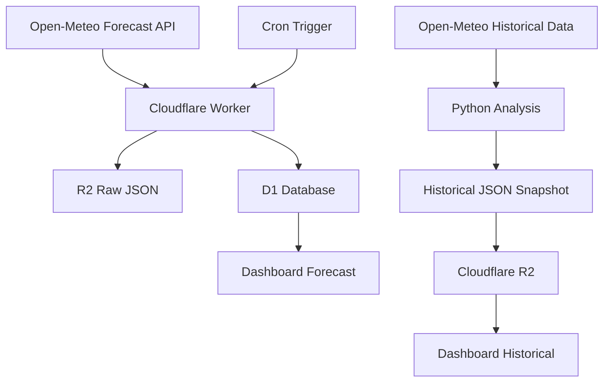

# Kelompok 4 — Pipeline Data Terbuka Serverless dan Dashboard

## Video Demo

Rekaman demo mandiri: https://youtu.be/6MHCbYvaQc8

## 1. Deskripsi Proyek

Proyek ini merupakan implementasi pipeline data cuaca Jakarta berbasis serverless menggunakan Cloudflare Workers, R2 Object Storage, dan D1 Database.

Sistem menggunakan Open-Meteo API sebagai sumber data publik untuk mengambil, memproses, menyimpan, dan menampilkan informasi suhu, kelembapan, serta curah hujan.

Terdapat dua bagian utama:

1. Pipeline prakiraan cuaca tiga hari yang berjalan otomatis.
2. Analisis historis cuaca selama satu tahun yang diproses oleh Analysis Layer.

Dashboard dapat diakses melalui:

https://topik1-cuaca-serverless.muhamadadrian279.workers.dev/

## 2. Tujuan

Proyek bertujuan untuk:

- Mengimplementasikan Function as a Service (FaaS).
- Mengotomatisasi pengambilan data publik.
- Menyimpan data menggunakan layanan cloud terkelola.
- Menyajikan analisis deskriptif dan tren cuaca.
- Mengintegrasikan Analysis Layer dan Infra & Ops Layer.
- Menerapkan monitoring dan penanganan kegagalan.
- Mengevaluasi estimasi serta biaya aktual cloud.

## 3. Sumber Data

Sumber: Open-Meteo API.

| Indikator | Field | Satuan |
|---|---|---|
| Suhu | `temperature_2m` | °C |
| Kelembapan | `relative_humidity_2m` | % |
| Curah hujan | `precipitation` | mm |

### Dataset Forecast

- Lokasi: Jakarta.
- Periode: prakiraan tiga hari.
- Resolusi: per jam.
- Pembaruan: setiap hari melalui Cron Trigger.
- Penyimpanan: R2 dan D1.

### Dataset Historis

- Periode: 16 November 2025–15 November 2026.
- Jumlah sampel valid: 8.760.
- Ringkasan harian: 365.
- Ringkasan bulanan/parsial: 13.
- Penyimpanan hasil analisis: R2.

Data historis menggunakan keluaran model/reanalisis Open-Meteo dan bukan pengamatan langsung stasiun BMKG.

Sumber: https://open-meteo.com/

## 4. Teknologi

| Teknologi | Fungsi |
|---|---|
| Cloudflare Workers | FaaS, API, dan dashboard |
| Cron Triggers | Otomatisasi pengambilan data |
| Cloudflare R2 | Penyimpanan JSON |
| Cloudflare D1 | Database hasil prakiraan |
| Cloudflare Observability | Monitoring dan logging |
| Python | Analisis historis |
| JavaScript | Worker dan pemrosesan data |
| SVG | Visualisasi grafik |
| GitHub | Source code dan dokumentasi |

## 5. Arsitektur Sistem



Penjelasan lengkap terdapat pada `docs/architecture.md`.

## 6. Struktur Repository

```text
project/
├── docs/
│   ├── architecture.md
│   ├── interface-contract.md
│   ├── analysis-report.md
│   ├── runbook.md
│   ├── cost-report.md
│   ├── security-scalability.md
│   ├── cross-review.md
│   ├── role-log.md
│   ├── ai-disclosure.md
│   └── evidence/
├── src/
│   ├── analysis/
│   ├── app/
│   │   └── worker.js
│   ├── infra/
│   └── config/
├── .gitignore
└── README.md
```

## 7. Reproduksi Analisis

Untuk menjalankan ulang analisis historis, gunakan Python dan dependensi pada repository.

```bash
pip install -r src/analysis/requirements.txt
python src/analysis/analysis.py
python src/analysis/build_dashboard_data.py
```

Hasil analisis tersedia pada `src/analysis/output/`.

Snapshot untuk dashboard tersimpan di `src/analysis/output/historical-dashboard.json` dan merupakan berkas yang sama dengan yang diunggah ke root bucket R2.

Jika hasil analisis diperbarui, file tersebut harus diunggah kembali secara manual ke root bucket R2.

## 8. Deployment Cloudflare

### Menyiapkan Worker

1. Login ke Cloudflare Dashboard.
2. Buka Workers & Pages.
3. Buat Worker `topik1-cuaca-serverless`.
4. Gunakan source `src/app/worker.js`.
5. Deploy Worker.

### Menyiapkan D1

Buat database:

`topik1-cuaca-db`

Jalankan skema dari:

`src/infra/schema.sql`

Hubungkan database ke Worker menggunakan binding:

`DB`

### Menyiapkan R2

Buat bucket:

`proyekcloudcomputing`

Hubungkan menggunakan binding:

`RAW`

Struktur objek:

```text
proyekcloudcomputing/
├── raw/
└── historical-dashboard.json
```

### Menyiapkan Secret

Tambahkan secret Worker:

`ADMIN_TOKEN`

Nilai secret tidak boleh dimasukkan ke GitHub.

### Menyiapkan Cron

Gunakan konfigurasi:

`0 0 * * *`

Jadwal tersebut berarti pukul 07.00 WIB setiap hari.

## 9. Endpoint

| Method | Endpoint | Fungsi |
|---|---|---|
| GET | `/` | Dashboard forecast |
| GET | `/history` | Dashboard historis |
| GET | `/health` | Health check |
| GET | `/api/results` | Hasil forecast |
| GET | `/api/status` | Status pipeline |
| GET | `/api/history` | Data historis |
| GET | `/api/history/csv` | Download CSV |
| POST | `/admin/run` | Eksekusi manual |

## 10. Pengujian Pipeline

Pengujian manual dapat dilakukan melalui Windows PowerShell.

```powershell
$token = Read-Host "Masukkan ADMIN_TOKEN"

Invoke-RestMethod `
  -Method POST `
  -Uri "https://topik1-cuaca-serverless.muhamadadrian279.workers.dev/admin/run" `
  -Headers @{"x-admin-token"=$token}

Remove-Variable token
```

Setelah eksekusi, periksa status terbaru pada D1.

```sql
SELECT started_at, status, row_count, error_message
FROM pipeline_runs
ORDER BY started_at DESC
LIMIT 10;
```

Pengujian mock pada repository revisi sebelumnya mencatat 18 tes lulus.

Pengujian lokal tersebut tidak menggantikan verifikasi deployment atau Cron setelah pembaruan source.

## 11. Dashboard

### Dashboard Prakiraan

Halaman `/` menampilkan:

- Rata-rata suhu prakiraan.
- Rata-rata kelembapan.
- Total curah hujan.
- Jumlah sampel valid.
- Grafik prakiraan.
- Tabel hasil pipeline.

Data diperoleh dari Cloudflare D1.

### Dashboard Historis

Halaman `/history` dirancang menampilkan:

- Jumlah sampel valid.
- Jumlah hari analisis.
- Statistik deskriptif.
- Grafik suhu dan kelembapan.
- Grafik curah hujan harian dan bulanan.
- Analisis tren dan uji musim.
- Validasi data.
- Tabel hasil analisis.
- Download CSV.

Data diperoleh dari `historical-dashboard.json` pada R2.

Endpoint JSON historis dan tampilan `/history` terlihat berjalan pada deployment live (`docs/evidence/history-dashboard.png`). Verifikasi ulang setelah deployment Worker terakhir belum dicatat; hasilnya dicantumkan di `docs/runbook.md` bagian 13.

## 12. Monitoring dan Biaya

Monitoring dilakukan menggunakan Cloudflare Observability serta tabel `pipeline_runs`.

Pada 23 November 2026, Billing Cloudflare menunjukkan total biaya aktual teramati sebesar US$0.00.

Hasil tersebut merupakan pengamatan awal, bukan tagihan final bulanan.

Laporan lengkap tersedia pada:

`docs/cost-report.md`

## 13. Pembagian Tugas

| Anggota | Akun GitHub | Peran |
|---|---|---|
| Samuel Pangestu | `samuelpangestu83-stack` | Analysis Layer: akuisisi dan validasi data, `analysis.py`, laporan analisis, snapshot historis |
| Muhammad Adrian | `adrian-project` | Infra & Ops Layer: Cloudflare Workers/D1/R2, dashboard, deployment, monitoring, runbook, biaya |

Detail kontribusi dicatat dalam `docs/role-log.md`.

## 14. Dokumentasi

| File | Deskripsi |
|---|---|
| `architecture.md` | Arsitektur cloud |
| `interface-contract.md` | Kontrak kedua layer |
| `analysis-report.md` | Analisis data |
| `runbook.md` | Operasional |
| `cost-report.md` | Biaya |
| `security-scalability.md` | Keamanan dan skalabilitas |
| `cross-review.md` | Review kedua layer |
| `role-log.md` | Kontribusi anggota |
| `ai-disclosure.md` | Penggunaan AI |

## 15. Kesimpulan

Proyek mengintegrasikan Cloudflare Workers sebagai FaaS, R2 Object Storage, D1 Database, dan Open-Meteo API dalam satu arsitektur serverless.

Pipeline prakiraan cuaca menggunakan Cron Trigger untuk melakukan pengambilan data otomatis.

Hasil analisis historis dari Analysis Layer juga diintegrasikan melalui snapshot JSON pada R2.

Sistem ini menunjukkan penerapan layanan cloud untuk pengambilan data, pengolahan, penyimpanan, monitoring, dan penyajian hasil analisis.
