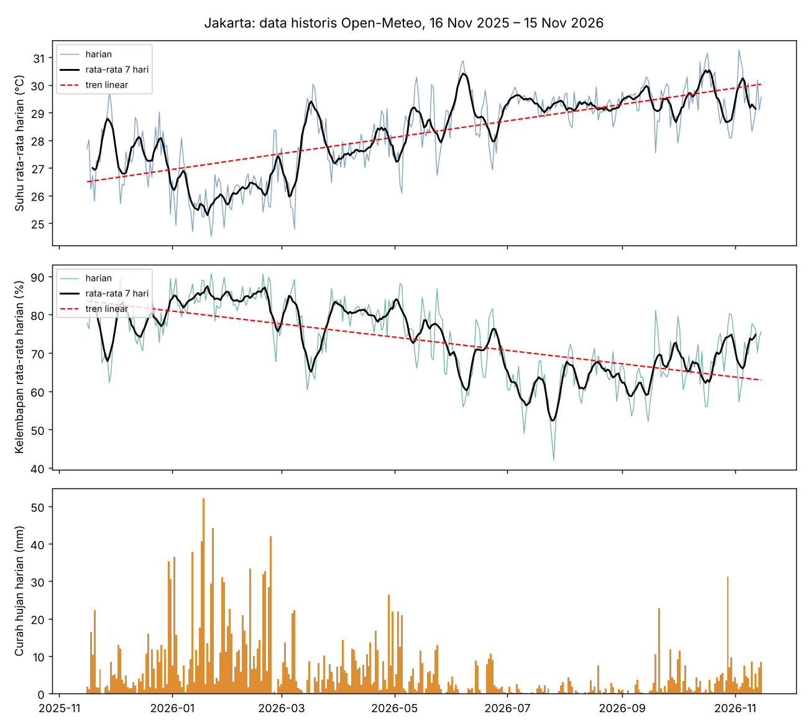
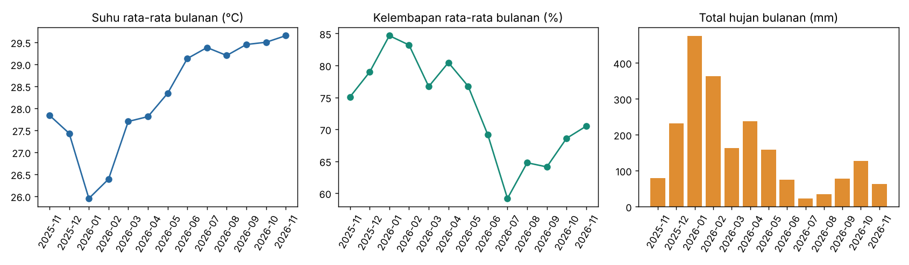
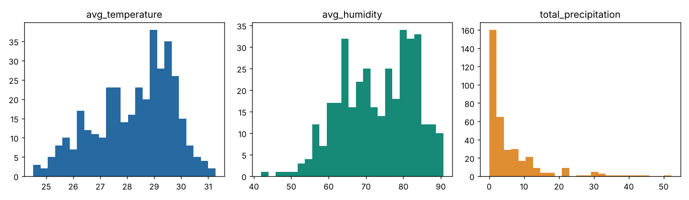

# Analysis Report: Analisis Deskriptif dan Tren Cuaca Jakarta

**Topik 1: Pipeline data terbuka serverless dan dashboard**  
**Layer:** Analysis (Samuel Pangestu)  
**Kode:** `src/analysis/analysis.py` · **Output:** `src/analysis/output/`  
Semua angka di dokumen ini dihasilkan oleh `python src/analysis/analysis.py` (lihat `README.md` untuk cara menjalankan ulang). Angka yang tidak diukur ditulis "tidak diukur".

## 1. Pertanyaan analisis

1. Seperti apa sebaran (deskriptif) suhu, kelembapan, dan curah hujan harian di Jakarta?
2. Apakah ada tren monoton pada ketiga indikator selama periode data, dan seberapa besar?
3. Apakah ada perbedaan curah hujan antara musim hujan dan musim kemarau?

## 2. Sumber data dan lisensi

| Item | Keterangan |
|---|---|
| Penyedia | Open-Meteo (https://open-meteo.com) |
| Lisensi | CC BY 4.0 untuk data API; API gratis untuk penggunaan non-komersial dengan batas 10.000 panggilan/hari (https://open-meteo.com/en/licence, https://open-meteo.com/en/terms; dicek 24 Nov 2026). Wajib mencantumkan tautan "Weather data by Open-Meteo.com" di tempat data ditampilkan. |
| Data personal | Tidak ada. |
| Indikator | `temperature_2m` (°C), `relative_humidity_2m` (%), `precipitation` (mm) |
| **Dataset historis (analisis)** | `openmeteo_jakarta_historical.json`: 8.760 baris per jam, 16 Nov 2025 00:00 s.d. 15 Nov 2026 23:00 (365 hari), zona waktu Asia/Jakarta, koordinat grid -6,221441 / 106,856186, elevasi 12 m |
| **Data forecast (pipeline cloud)** | Endpoint `forecast` 3 hari per jam, koordinat permintaan -6,2088 / 106,8456 |

Catatan penting tentang kedua sumber:

- Data historis dan data forecast **bukan pengukuran stasiun cuaca**. Keduanya keluaran model/reanalisis cuaca. Model tepat yang dipakai file historis tidak tercatat di dalam JSON, sehingga **tidak diverifikasi**.
- Koordinat pada berkas historis (-6,2214; 106,8562) berbeda dari koordinat permintaan forecast (-6,2088; 106,8456) karena Open-Meteo memetakan titik ke sel grid. Selisihnya kecil tetapi nyata, sehingga hasil analisis historis dan dashboard forecast tidak boleh dibaca sebagai deret yang sama persis.

## 3. Validasi dan pembersihan data

Aturan validasi sengaja disamakan dengan `src/app/worker.js` (nilai numerik terhingga, kelembapan 0 sampai 100, curah hujan ≥ 0).

| Pemeriksaan | Hasil |
|---|---|
| Jumlah baris | 8.760 |
| Nilai kosong (suhu / kelembapan / hujan) | 0 / 0 / 0 |
| Timestamp duplikat | 0 |
| Jam hilang dalam rentang | 0 |
| Baris tidak valid (dibuang) | 0 |
| Baris valid | 8.760 |

Karena tidak ada nilai hilang pada data historis ini, **penanganan nilai hilang tidak teruji pada dataset ini**. Logika pembuangan baris tidak valid hanya teruji oleh simulasi kegagalan di sisi Worker (lihat `docs/runbook.md` bagian 14), bukan oleh data nyata yang bermasalah.

**Cek silang** terhadap agregat harian bawaan Open-Meteo (`daily` pada berkas yang sama): selisih maksimum rata-rata suhu 0,08 °C, kelembapan 0,58 poin persen, total hujan 0,0 mm. Penyebab selisih kecil pada suhu dan kelembapan tidak diselidiki (dugaan: pembulatan), jadi tetap berstatus dugaan.

## 4. Metode

- **Agregasi harian** (sama dengan Worker): rata-rata suhu, rata-rata kelembapan, total curah hujan per tanggal. Kode analisis juga menghitung suhu min/maks harian, yang belum ada di kontrak.
- **Deskriptif:** rerata, median, simpangan baku, kuartil, min/maks, kemencengan; korelasi Spearman antarindikator (dipilih karena hujan sangat menceng ke kanan).
- **Tren:** regresi linear terhadap hari (OLS) sebagai ukuran besar tren, ditambah uji Kendall τ sebagai uji monoton tanpa asumsi distribusi.
  - H₀: tidak ada tren (kemiringan = 0). H₁: kemiringan ≠ 0. α = 0,05.
- **Pemeriksaan asumsi OLS:** normalitas residual (Shapiro-Wilk), independensi residual (autokorelasi lag-1 dan statistik Durbin-Watson).
- **Koreksi autokorelasi:** selang kepercayaan 95% kedua dihitung dengan ukuran sampel efektif n_eff = n(1−r₁)/(1+r₁).
- **Perbandingan musim:** uji Mann-Whitney U (dua sisi) atas curah hujan harian bulan Des–Mar versus Jun–Sep. Uji non-parametrik dipilih karena distribusi hujan menceng.

## 5. Hasil

### 5.1 Statistik deskriptif harian (n = 365 hari)

| Indikator | Rerata | Median | Std | Min | Maks |
|---|---:|---:|---:|---:|---:|
| Suhu rata-rata harian (°C) | 28,26 | 28,52 | 1,44 | 24,52 | 31,27 |
| Kelembapan rata-rata harian (%) | 73,22 | 74,38 | 9,72 | 41,96 | 90,67 |
| Curah hujan harian (mm) | 5,78 | 2,70 | 8,24 | 0,00 | 52,20 |

- Total curah hujan periode ini 2.107,9 mm. Terdapat 262 hari dengan hujan ≥ 1 mm dan 103 hari < 1 mm.
- Curah hujan sangat menceng ke kanan (kemencengan 2,56): rerata jauh di atas median karena sedikit hari dengan hujan sangat lebat.
- Korelasi Spearman antar-harian: suhu–kelembapan −0,92; suhu–hujan −0,67; kelembapan–hujan +0,76. Ini korelasi, bukan sebab-akibat.

### 5.2 Pola bulanan

| Bulan | Suhu (°C) | Kelembapan (%) | Hujan (mm) | Hari hujan ≥ 1 mm |
|---|---:|---:|---:|---:|
| 2025-11* | 27,84 | 75,07 | 79,4 | 12 |
| 2025-12 | 27,43 | 78,97 | 231,5 | 30 |
| 2026-01 | 25,95 | 84,66 | 474,6 | 30 |
| 2026-02 | 26,39 | 83,20 | 363,1 | 25 |
| 2026-03 | 27,70 | 76,70 | 163,4 | 24 |
| 2026-04 | 27,81 | 80,45 | 237,4 | 29 |
| 2026-05 | 28,34 | 76,76 | 158,2 | 24 |
| 2026-06 | 29,13 | 69,16 | 75,5 | 18 |
| 2026-07 | 29,38 | 59,18 | 22,1 | 10 |
| 2026-08 | 29,20 | 64,77 | 34,8 | 10 |
| 2026-09 | 29,45 | 64,12 | 77,5 | 14 |
| 2026-10 | 29,50 | 68,59 | 127,6 | 21 |
| 2026-11* | 29,65 | 70,50 | 62,8 | 15 |

\* Bulan parsial: Nov 2025 hanya 15 hari (16–30), Nov 2026 hanya 15 hari (1–15). Total hujan dua baris ini tidak sebanding dengan bulan penuh.

Puncak hujan jatuh pada Januari 2026 (474,6 mm) dan titik terendah pada Juli 2026 (22,1 mm); suhu bergerak berlawanan arah.

### 5.3 Uji tren (H₀: kemiringan = 0)

| Indikator | Kemiringan per 30 hari | SK 95% naif | SK 95% terkoreksi autokorelasi | R² | Kendall τ (p) | Keputusan |
|---|---:|---|---|---:|---|---|
| Suhu (°C) | +0,29 | [0,26; 0,32] | [0,21; 0,38] | 0,50 | 0,51 (p < 0,001) | Tolak H₀ |
| Kelembapan (poin %) | −1,70 | [−1,93; −1,48] | [−2,45; −0,96] | 0,38 | −0,41 (p < 0,001) | Tolak H₀ |
| Hujan (mm/hari) | −0,81 | [−1,03; −0,58] | [−1,13; −0,49] | 0,12 | −0,25 (p < 0,001) | Tolak H₀ |

Pemeriksaan asumsi OLS:

| Indikator | Shapiro-Wilk residual (p) | Autokorelasi lag-1 | Durbin-Watson | n efektif |
|---|---:|---:|---:|---:|
| Suhu | 0,475 (normal tidak ditolak) | 0,77 | 0,46 | ≈ 48 |
| Kelembapan | 0,0005 (normalitas ditolak) | 0,82 | 0,35 | ≈ 36 |
| Hujan | ≈ 4×10⁻²² (normalitas ditolak) | 0,32 | 1,35 | ≈ 186 |

Asumsi independensi residual **dilanggar** pada suhu dan kelembapan (Durbin-Watson jauh di bawah 2), dan normalitas residual dilanggar pada kelembapan dan hujan. Akibatnya p-value OLS terlalu kecil dan SK naif terlalu sempit. Uji Kendall τ bebas asumsi distribusi, tetapi tetap mengasumsikan pengamatan independen, sehingga p-value-nya juga terlalu kecil pada deret yang berautokorelasi seperti ini; p-value Kendall dan Mann-Whitney tidak boleh dibaca sebagai bukti kuat. Keputusan karena itu bertumpu pada SK terkoreksi autokorelasi, yang tetap tidak memuat nol untuk ketiga indikator. Metode yang memperhitungkan autokorelasi (misalnya modified Mann-Kendall atau block bootstrap) tidak dijalankan; ini keterbatasan analisis.

### 5.4 Musim hujan vs kemarau

Median hujan harian Des–Mar adalah 6,5 mm (n = 121 hari) dan Jun–Sep adalah 0,55 mm (n = 122 hari). Uji Mann-Whitney: U = 12.625, p ≈ 9×10⁻²². **Tolak H₀** (distribusi hujan harian kedua periode sama). Pengelompokan bulan musim ditetapkan peneliti dari pola bulanan di 5.2, bukan dari klasifikasi resmi BMKG.

## 6. Interpretasi

Selama 16 Nov 2025 – 15 Nov 2026, garis regresi suhu rata-rata harian Jakarta menanjak, sedangkan garis kelembapan dan hujan menurun dari awal ke akhir periode. Besarnya: sekitar +0,29 °C, −1,7 poin kelembapan, dan −0,81 mm/hari per 30 hari. Pola ini selaras dengan peralihan dari musim hujan (puncak Januari) ke kemarau (terendah Juli), lalu mulai berbalik pada Oktober–November.

## 7. Batas kesimpulan

1. **Ini bukan tren iklim.** Satu tahun penuh hanya berisi satu siklus musiman. Garis "tren" di 5.3 pada dasarnya menangkap setengah gelombang musiman, bukan perubahan jangka panjang. Data ini tidak cukup untuk memisahkan tren dari musim; itu butuh beberapa tahun data dan model musiman (mis. dekomposisi STL). **Dilarang** menyimpulkan pemanasan atau pengeringan Jakarta dari hasil ini.
2. **Signifikansi statistik tidak sama dengan makna praktis.** Dengan 365 pengamatan yang saling berkorelasi, p-value sangat kecil dihasilkan bahkan oleh pola musiman biasa.
3. **Data model, bukan observasi.** Nilai tidak divalidasi terhadap stasiun BMKG; akurasi data historis maupun forecast **tidak diukur**.
4. **Pemisahan jalur forecast otomatis dan snapshot historis.** Pipeline otomatis (Cron Trigger) hanya memproses data forecast 3 hari dan menyimpannya ke D1 (`daily_forecast`), tanpa mengevaluasi akurasi ramalan. Sementara itu, hasil analisis historis satu tahun dihasilkan secara manual dari `src/analysis/analysis.py`, dibangun menjadi `historical-dashboard.json` dengan `src/analysis/build_dashboard_data.py` dan diunggah manual ke root bucket Cloudflare R2, dan disajikan terpisah melalui endpoint `GET /api/history` serta halaman `/history` (lihat Revisi V1.1 pada `docs/interface-contract.md` dan `docs/cross-review.md`).
5. Dua bulan parsial (Nov 2025, Nov 2026) tidak sebanding dengan bulan penuh.
6. Korelasi antar-indikator tidak menunjukkan sebab-akibat.

## 8. Reproduksibilitas

```bash
pip install -r src/analysis/requirements.txt
python src/analysis/analysis.py
python src/analysis/build_dashboard_data.py
```

`analysis.py` bersifat deterministik (tanpa komponen acak) dan membaca `src/analysis/data/openmeteo_jakarta_historical.json`. Luaran: `summary.json`, `validation.json`, `daily.csv`, `monthly.csv`, `trend.csv`, dan tiga grafik PNG. `build_dashboard_data.py` hanya menggabungkan `summary.json`, `daily.csv`, dan `monthly.csv` menjadi `historical-dashboard.json` (tanpa perhitungan statistik baru) untuk dibaca halaman `/history`; berkas itu diunggah manual ke root bucket R2 (`docs/runbook.md` bagian 7). Untuk mengunduh ulang data historis bisa memakai endpoint arsip Open-Meteo dengan koordinat dan periode yang sama; hasil unduhan ulang dapat berbeda bila Open-Meteo memperbarui modelnya (tidak diuji).

## 9. Skema output untuk dashboard

- `daily.csv`: `forecast_date, avg_temperature, min_temperature, max_temperature, avg_humidity, total_precipitation, hourly_samples`.
- `monthly.csv`: `month, avg_temperature, avg_humidity, total_precipitation, rainy_days_ge_1mm`.
- `summary.json`: blok `validation`, `descriptive`, `trend`, `season_test`.
- `historical-dashboard.json`: `metadata`, `daily` (kolom tanggal bernama `date`), `monthly`, `descriptive`, `validation`, `trend`, `season_test`.

Nama kolom `avg_temperature`, `avg_humidity`, `total_precipitation`, `hourly_samples` identik dengan tabel `daily_forecast` di kontrak.

## 10. Grafik




