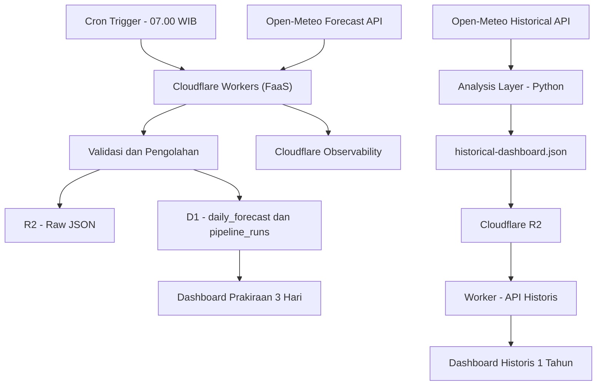

# Architecture — Serverless Weather Data Pipeline

## 1. Gambaran Umum

Proyek ini menerapkan arsitektur serverless menggunakan Cloudflare untuk mengambil, memproses, menyimpan, dan menampilkan data cuaca Jakarta dari Open-Meteo API.

Sistem menggunakan Cloudflare Workers sebagai Function as a Service (FaaS), Cloudflare R2 sebagai object storage, dan Cloudflare D1 sebagai database terkelola.

Terdapat dua jalur data dalam sistem:

1. Pipeline prakiraan cuaca tiga hari yang berjalan otomatis setiap hari.
2. Analisis historis satu tahun yang diolah oleh Analysis Layer dan disimpan sebagai snapshot JSON pada R2.

## 2. Diagram Arsitektur

## 3. Komponen Infrastruktur

| Komponen | Fungsi |
|---|---|
| Cloudflare Workers | Menjalankan pipeline, endpoint API, dan dashboard |
| Cron Triggers | Menjalankan pipeline secara otomatis |
| Cloudflare R2 | Menyimpan JSON mentah dan snapshot historis |
| Cloudflare D1 | Menyimpan hasil prakiraan dan riwayat eksekusi |
| Cloudflare Observability | Monitoring dan pencatatan error |
| Open-Meteo API | Sumber data cuaca |
| Chart SVG | Menampilkan grafik langsung dari hasil pemrosesan Worker |

## 4. Alur Pipeline Otomatis

Pipeline otomatis berjalan melalui tahapan berikut:

1. Cron Trigger menjalankan Worker pada pukul 07.00 WIB.
2. Worker melakukan request ke Open-Meteo Forecast API.
3. Data JSON divalidasi berdasarkan struktur array, nilai numerik, kelembapan, dan curah hujan.
4. Data mentah disimpan ke R2 dengan lokasi `raw/{run_id}.json`.
5. Data dikelompokkan berdasarkan tanggal.
6. Rata-rata suhu, rata-rata kelembapan, dan total curah hujan dihitung.
7. Hasil disimpan pada tabel `daily_forecast` di D1.
8. Status eksekusi dicatat pada tabel `pipeline_runs`.
9. Dashboard membaca hasil dari eksekusi yang terakhir berhasil.

Jadwal Cron:

`0 0 * * *` (UTC) = 07.00 WIB.

## 5. Alur Data Historis

Analysis Layer menggunakan data historis Open-Meteo untuk periode 16 November 2025 sampai 15 November 2026.

Dataset terdiri atas 8.760 sampel valid yang diringkas menjadi 365 data harian dan 13 kelompok bulanan, termasuk bulan parsial.

Hasil analisis meliputi statistik deskriptif, tren suhu, tren kelembapan, curah hujan, validasi data, dan perbandingan musim.

Hasil tersebut dikemas ke dalam `historical-dashboard.json` dan diunggah secara manual ke root bucket R2.

Worker membaca file tersebut melalui binding `RAW` dan menyediakan endpoint `/api/history`.

Data historis tidak diperbarui oleh Cron prakiraan. Pembaruannya dilakukan melalui eksekusi ulang kode Analysis Layer dan upload snapshot terbaru.

## 6. Alasan Memilih FaaS

Cloudflare Workers dipilih karena pipeline hanya membutuhkan eksekusi secara periodik serta layanan API dan dashboard yang relatif ringan.

Dengan FaaS, kelompok tidak perlu melakukan konfigurasi sistem operasi, patching Virtual Machine, atau menjalankan server sendiri secara terus-menerus.

### Perbandingan dengan IaaS

| Aspek | Cloudflare Workers (FaaS) | Virtual Machine (IaaS) |
|---|---|---|
| Pengelolaan server | Tidak diperlukan | Dikelola pengguna |
| Pengambilan otomatis | Cron Trigger | Cron pada VM |
| Deployment | Deploy Worker | Instalasi dan konfigurasi aplikasi |
| Skalabilitas | Dikelola platform dalam batas layanan | Perlu pengaturan resource |
| Biaya aktual proyek | US$0,00 pada pengamatan 23 November 2026 | Tidak diukur |

Untuk kebutuhan proyek yang memiliki satu pengambilan forecast per hari, FaaS dinilai lebih sederhana dari sisi pengelolaan.

## 7. Monitoring dan Penanganan Kegagalan

Cloudflare Observability digunakan untuk memeriksa invocation dan log.

Pipeline memiliki status:

- `running`: eksekusi sedang berlangsung.
- `success`: pengambilan dan penyimpanan berhasil.
- `failed`: terdapat kesalahan selama proses.

Jika API sumber gagal atau seluruh data tidak valid, sistem mencatat kegagalan apabila database masih tersedia.

Dashboard tetap membaca hasil dari pipeline sukses terakhir.

Pengujian awal telah mencakup simulasi kegagalan API dan pemulihan melalui eksekusi normal berikutnya.

## 8. Keamanan

Endpoint `/admin/run` dilindungi secret `ADMIN_TOKEN`.

Bucket R2 tidak perlu diatur sebagai publik karena Worker mengaksesnya melalui binding.

Kredensial tidak boleh disimpan dalam source code, repository, ataupun rekaman demo.

## 9. Status Implementasi

| Komponen | Status |
|---|---|
| Worker dan API forecast | Sudah diuji |
| R2 dan D1 | Sudah diuji |
| Cron otomatis versi awal | Sudah diuji |
| API historis | Sudah diuji |
| Dashboard historis versi terbaru | Terlihat berjalan pada deployment live (`history-dashboard.png`); verifikasi ulang setelah deploy terakhir belum dicatat |
| Cron setelah pembaruan Worker | Eksekusi 25 Nov 2026 pukul 07.00 WIB `pipeline_success` (`cron-scheduled.png`); belum dapat dipastikan berjalan dengan versi Worker terakhir |

## 10. Kesimpulan

Arsitektur Cloudflare memungkinkan integrasi antara pipeline prakiraan otomatis dan hasil analisis historis dalam satu layanan berbasis serverless.

Penggunaan Workers, R2, dan D1 mendukung pemrosesan data, penyimpanan, monitoring, serta visualisasi tanpa kebutuhan pengelolaan Virtual Machine secara langsung.
