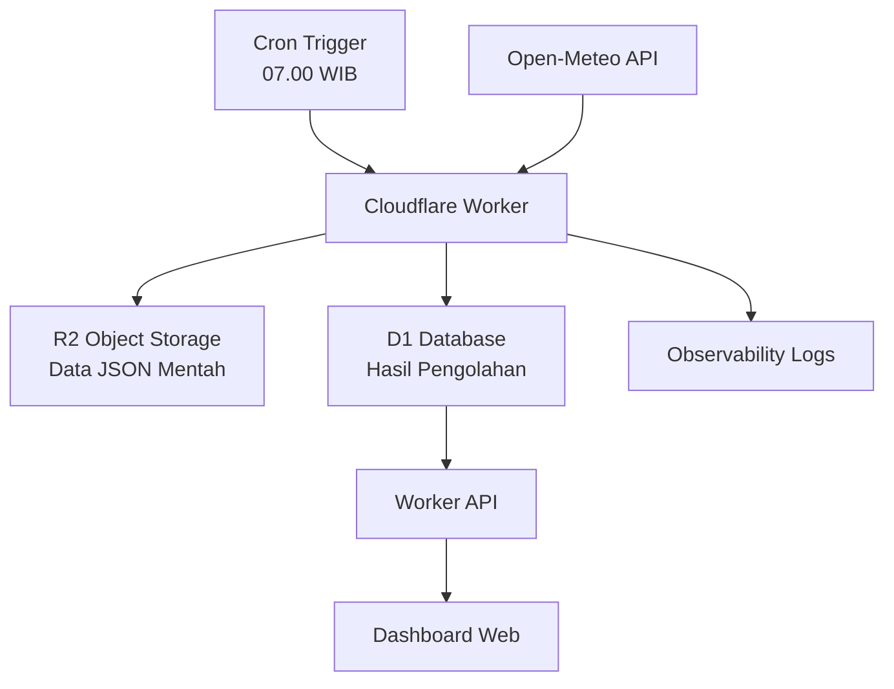

# Arsitektur Sistem

## 1. Gambaran Umum

Proyek ini menggunakan arsitektur serverless berbasis Cloudflare untuk mengambil dan mengolah data prakiraan cuaca Jakarta secara otomatis.

Data diperoleh dari Open-Meteo API dengan tiga indikator utama, yaitu suhu udara, kelembapan, dan curah hujan.

Proses pengambilan dan pengolahan data dijalankan menggunakan Cloudflare Workers. Data mentah disimpan pada R2 Object Storage, sedangkan hasil pengolahannya disimpan dalam database D1.

Hasil analisis kemudian ditampilkan melalui dashboard web yang dapat diakses menggunakan browser.

## 2. Diagram Arsitektur

## 3. Layanan yang Digunakan

| Layanan | Fungsi |
|---|---|
| Cloudflare Workers | Mengambil dan mengolah data secara serverless |
| Cron Triggers | Menjalankan pipeline secara otomatis |
| Cloudflare R2 | Menyimpan data JSON mentah |
| Cloudflare D1 | Menyimpan hasil analisis dan riwayat eksekusi |
| Cloudflare Observability | Memantau aktivitas dan kesalahan sistem |
| Open-Meteo API | Sumber data prakiraan cuaca |
| Dashboard Web | Menampilkan hasil analisis |

## 4. Alur Kerja Sistem

1. Cron Trigger memanggil Cloudflare Worker setiap hari pada pukul 07.00 WIB.
2. Worker mengambil data prakiraan cuaca Jakarta melalui Open-Meteo API.
3. Data JSON mentah disimpan ke Cloudflare R2.
4. Worker melakukan validasi, mengabaikan nilai yang tidak valid, dan menghitung rata-rata suhu, rata-rata kelembapan, serta total curah hujan per hari.
5. Hasil pengolahan disimpan dalam tabel daily_forecast pada Cloudflare D1.
6. Riwayat eksekusi dicatat dalam tabel pipeline_runs.
7. Dashboard membaca hasil terbaru dari D1 melalui endpoint API Worker.

## 5. Alasan Pemilihan Arsitektur

Arsitektur serverless dipilih karena sistem tidak memerlukan server virtual yang harus dijalankan dan dikelola secara terus-menerus.

Cloudflare Workers digunakan sebagai layanan Function as a Service (FaaS), sementara R2 dan D1 menyediakan layanan penyimpanan terkelola.

Dengan pendekatan ini, proses pengambilan data dapat berjalan sesuai jadwal tanpa mengharuskan anggota kelompok menjalankan program secara manual.

Arsitektur ini juga memungkinkan penggunaan resource berdasarkan kebutuhan eksekusi, sehingga lebih sederhana untuk dikelola dalam lingkup proyek.

## 6. Monitoring dan Penanganan Kegagalan

Sistem menggunakan Cloudflare Observability untuk memantau aktivitas Worker.

Jika proses pengambilan data mengalami kegagalan, Worker mencatat status failed dan pesan kesalahan ke tabel pipeline_runs, selama database masih dapat diakses.

Dashboard tetap menggunakan hasil dari eksekusi terakhir yang berhasil, sehingga data sebelumnya tidak langsung hilang ketika terjadi kegagalan pengambilan data baru.

Pengujian dilakukan melalui simulasi kegagalan API, pemeriksaan log, dan eksekusi ulang pipeline secara normal.

## 7. Hasil Implementasi

Implementasi awal telah menunjukkan bahwa:

- Worker dapat mengambil data dari Open-Meteo API.
- Data mentah dapat disimpan pada Cloudflare R2.
- Hasil pengolahan dapat disimpan pada Cloudflare D1.
- Cron Trigger berhasil memanggil Worker secara otomatis.
- Dashboard dapat menampilkan ringkasan dan grafik tiga indikator.
- Simulasi kegagalan API berhasil dicatat dan pipeline dapat dijalankan kembali.

Pengujian Cron dilakukan menggunakan interval 15 menit. Setelah pengujian, jadwal dikonfigurasi menjadi satu kali sehari pada pukul 07.00 WIB.

## 8. Batasan Sistem

Data yang digunakan merupakan prakiraan cuaca tiga hari, bukan hasil pengukuran cuaca aktual.

Analisis yang ditampilkan terbatas pada statistik deskriptif dan tren harian dari data prakiraan tersebut.

Sistem belum dirancang untuk melakukan pengujian akurasi ramalan cuaca ataupun analisis perubahan iklim jangka panjang.

